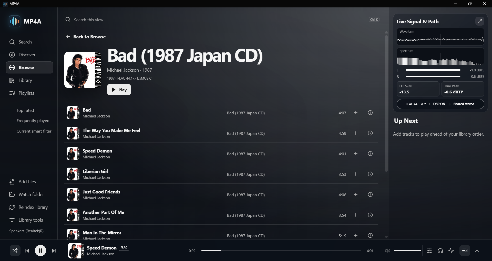
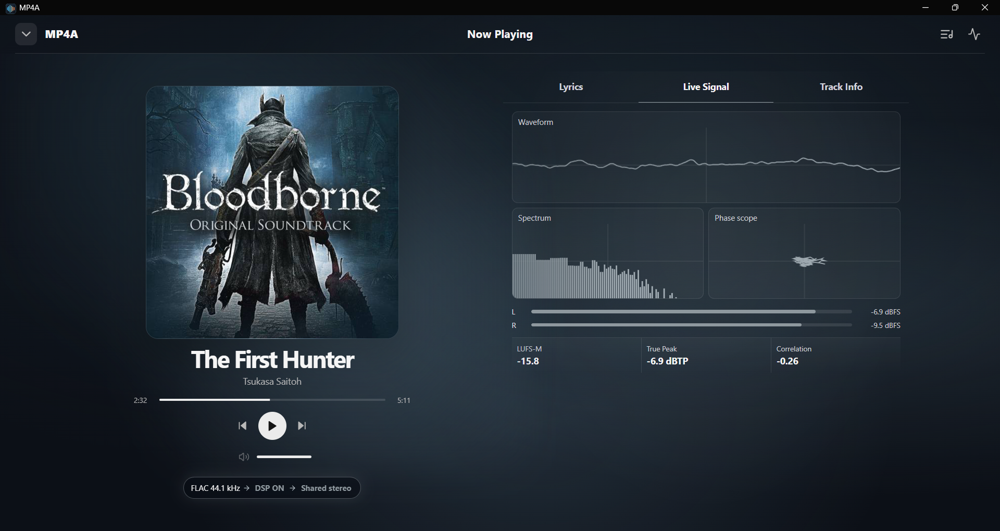
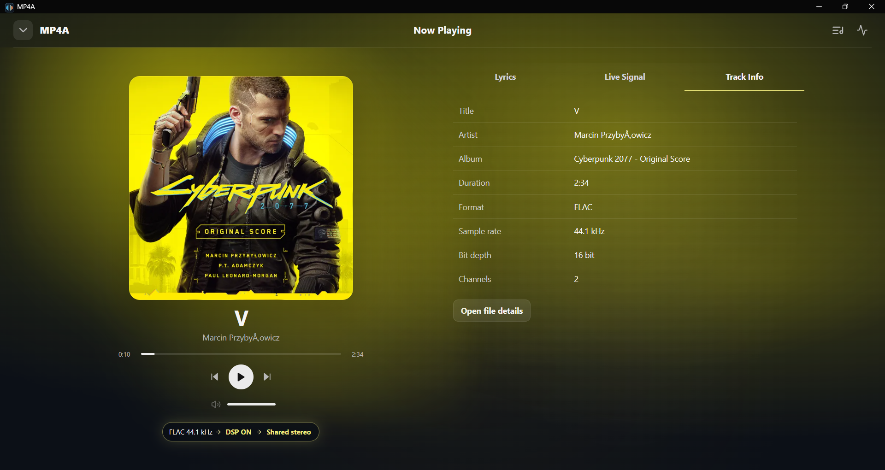

# MP4A

A local music player for Windows 11 x64 with headphone DSP, flexible audio output, and a live view of the playback signal.

[Download for Windows](https://github.com/Pragadeesh043/MP4A/releases/latest) · [Report an issue](https://github.com/Pragadeesh043/MP4A/issues) · [Privacy policy](PRIVACY.md)

## Features

- **Local library** — Watch music folders or add individual files. Browse albums, search your collection, and create playlists. Your music stays in its original folders.
- **Headphone DSP** — Use 10-band graphic EQ, parametric EQ, V, M, W, and U curves, crossfeed, FIR convolution, normalization, and limiting. Save your own presets.
- **Windows audio output** — Choose shared output, binaural playback, WASAPI exclusive PCM, or device-dependent DoP and native DSD via ASIO. Gapless playback is available across compatible tracks.
- **Signal inspection** — See the waveform, spectrum, loudness, true peak, and output path while music plays.

## Install and play

1. Download and run **MP4A-Setup-x64.exe** from [Releases](https://github.com/Pragadeesh043/MP4A/releases). The GitHub installer is unsigned.
2. Open MP4A and choose **Watch folder** or **Add files**. If prompted, install the Microsoft Edge WebView2 Evergreen Runtime and select **Reload Glassroom**. [WebView2 download](https://developer.microsoft.com/microsoft-edge/webview2/#download-section)
3. Open **DSP → 10-band graphic EQ** to select a curve, then click **Apply DSP**.

The installer bundles FFmpeg, FFprobe, .NET, and the Windows App SDK runtime. SACD ISO import requires the optional [sacd_extract helper](https://github.com/EuFlo/sacd-ripper/releases/tag/0.3.9.3b). Use **Settings → Apps → Installed apps** to uninstall MP4A.

## Screenshots

| Live signal | Track details | Synchronized lyrics |
| --- | --- | --- |
|  |  |  |

## Project documentation

- [Build and contribute](docs/development.md)
- [Audio modes, DSP, and verification](docs/audio.md)
- [Release checklist](docs/release.md)
- [Third-party notices](THIRD-PARTY-NOTICES.md) and [FFmpeg source archive](https://github.com/Pragadeesh043/MP4A/releases/download/v1.0.1/MP4A-FFmpeg-8.0.3-win64-source.tar.gz)

MP4A is available under the [MIT license](LICENSE). Third-party components retain their own licenses.
