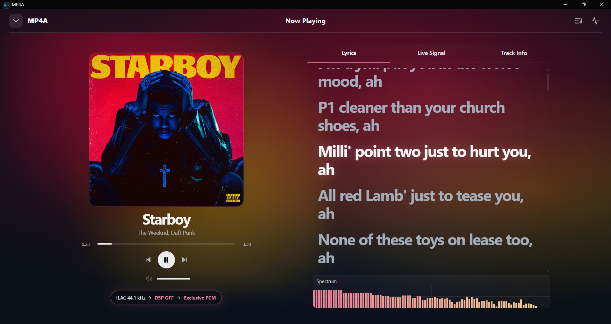

# MP4A — Music Player 4 Audiophiles

**MP4A** (**M**usic **P**layer **4** **A**udiophiles) is a local Windows 11 desktop music player built for bit-perfect playback, headphone DSP, and real-time signal inspection. It indexes and plays music from its original location on your PC.

[**Download**](https://github.com/Pragadeesh043/MP4A/releases/latest) · [Microsoft Store](https://apps.microsoft.com/) · [Report an Issue](https://github.com/Pragadeesh043/MP4A/issues) · [Privacy Policy](PRIVACY.md)

## Features

### Local Library & Navigation

- **Import and browse.** Watch folders, add individual files, or reindex the library. Browse albums and editions, filter by folder, or sort tracks by artist or album artist. Discover rotates featured albums and shows recently played tracks.
- **Search and playlists.** Press `Ctrl+K` to search the current view as you type. Music searches match titles, artists, albums, and metadata tags. Open **Top rated** (four stars or more) or **Frequently played** (three plays or more), or save filters for codec, sample rate, bit depth, dynamic range, genre, year, rating, and play count as smart playlists.
- **Up Next.** Add, play, or remove queued tracks ahead of the current album, playlist, or library order. Shuffle playback and control it through Windows media controls.
- **Formats.** Play FLAC, ALAC, WAV, AIFF/AIFC, WavPack, APE, TAK, AAC, MP3, Opus, Ogg Vorbis, Musepack, DSF, and DSDIFF. Open CUE sheets as individual tracks and import SACD ISOs with the optional helper below.

### Windows Audio Output & Bit-Perfect Playback

- **PCM output.** Use shared stereo, binaural headphones with Steam Audio HRTF, or 7.1 output for a device or HeSuVi. WASAPI Exclusive direct PCM negotiates sample rate and bit depth per track and preserves decoded integer samples during playback, with DSP bypassed. Exclusive DSP mode adds double-precision resampling with linear or minimum phase and optional dither or noise shaping.
- **DSD output.** Play uncompressed DSD via WASAPI Exclusive DSD over PCM (DoP) with a compatible DAC, or via native DSD with a compatible 64-bit ASIO driver. DSD decoding to PCM is also available.
- **Playback and profiles.** Play compatible neighboring tracks gaplessly, preload tracks within a configurable RAM limit, and adjust PCM pause and resume fades. Save per-device routing, DSP, and volume settings, including digital volume, fixed line-out, and hardware volume and mute where supported.
- **Signal path.** The live pill shows **Format → DSP State → Output Mode**. Open the Signal Inspector for the negotiated stream format, processing stages, and available hardware readback.

### Headphone DSP & Acoustic Processing

- **Equalization.** Adjust the 10-band graphic EQ or start with a V, M, W, or U curve. Build a parametric EQ with up to 64 bands, adjustable frequency, gain, and Q, eight filter shapes, and separate L/R response curves. Import AutoEQ or compatible Equalizer APO presets.
- **Headphone and stereo controls.** Adjust crossfeed, preamp, bass shelf, stereo width, balance, and polarity. Load mono or stereo PCM WAV impulses for FIR convolution.
- **Loudness and presets.** Apply track or album ReplayGain or R128 normalization with adjustable headroom and stereo true-peak brickwall limiting. Save and recall your own DSP presets.

### Real-Time Signal Inspection

- **Plots and meters.** View a live waveform oscilloscope, FFT spectrum analyzer, and stereo phase scope. Monitor per-channel peak levels in dBFS, including L/R, with peak hold, plus `LUFS-M`, **True Peak** in dBTP, and stereo **Correlation**.
- **Diagnostics.** Inspect source and output peak, RMS, and clipping, plus limiter gain reduction. Raw DSD routes show transport details.

### Now Playing, Lyrics & Metadata

- **Now Playing.** Expand the player for an ambient backdrop drawn from album art. Follow time-synced lyrics from embedded tags or a matching `.lrc` file, and select a line to seek.
- **Track Info.** See format, sample rate, bit depth, channels, bitrate, and duration. Open file details for the path, container, size, tags, and rating. View full-size artwork and local PDF booklets.
- **File analysis.** Scan tracks or editions for loudness and ReplayGain. Track scans also report true peak, estimated dynamic range, spectral cutoff checks, and file integrity via FLAC PCM MD5 verification or a SHA-256 hash.

## Screenshots

| Live Signal | Track Info | Synchronized Lyrics |
| --- | --- | --- |
|  |  |  |
| Waveform, spectrum, and levels | Format, sample rate, and channels | Lyrics that follow playback |

## Installation & System Requirements

- **Microsoft Store.** Search for **MP4A** by **Pragadeesh** and select **Install** if it’s available in your region. [Open Microsoft Store](https://apps.microsoft.com/)
- **GitHub Releases.** Download and run `MP4A-Setup-x64.exe`. The GitHub installer is unsigned. [Get the installer](https://github.com/Pragadeesh043/MP4A/releases/latest)

Windows 11 x64 is the target platform. The installer and Store package bundle FFmpeg, FFprobe, .NET, and the Windows App SDK runtime. The interface requires WebView2 Evergreen. If prompted, install the runtime and choose **Reload Glassroom**. [Download WebView2](https://developer.microsoft.com/microsoft-edge/webview2/#download-section)

Open MP4A and choose **Watch folder** or **Add files** to start building your library.

For SACD ISO import, place the optional `sacd_extract.exe` in the installed `Tools/SACD` folder or on `PATH`. [Download the SACD helper](https://github.com/EuFlo/sacd-ripper/releases/tag/0.3.9.3b)

## Documentation & License

- [Build and contribute](docs/development.md)
- [Audio modes and DSP](docs/audio.md) · [Verification notes](docs/audio.md#verification)
- [Release checklist](docs/release.md) · [Changelog](CHANGELOG.md)
- [Third-party notices](THIRD-PARTY-NOTICES.md) and [FFmpeg source archive](https://github.com/Pragadeesh043/MP4A/releases/download/v1.0.1/MP4A-FFmpeg-8.0.3-win64-source.tar.gz)

MP4A is available under the [MIT License](LICENSE). Third-party components retain their own licenses.
