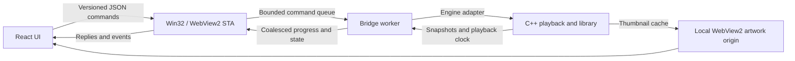

# Glassroom

Glassroom contains the React, TypeScript, Tailwind CSS, and Motion frontend shared by MP4A and its demos. The production MP4A installer uses the WinUI 3 and C# host in `src/Soundroom`. The optional C++ host exercises the same frontend and bridge with a simulated engine.

## Run the starter

Use Node 22.12+ or a supported newer version. Start the browser demo from this directory.

```powershell
Set-Location ui
npm.cmd ci
npm.cmd run dev
```

Open the localhost address Vite prints. The fixture uses original artwork, a small catalog, two playlists, sample timestamped lyrics for **Low Tide**, and synthesized audio in the browser. Use **Play album**, click the current artwork to expand, and open **Queue** to jump to or remove upcoming songs. Click a lyric to seek. **Ctrl+K** focuses search and **Esc** closes the queue or expanded player.

For the desktop host, install the **Desktop development with C++** workload with an x64 MSVC compiler and Windows SDK, CMake 3.25+, Git, and the WebView2 Evergreen Runtime. Run these commands from `src/Glassroom`.

```powershell
.\build-native.ps1
.\native\bin\Release\Glassroom.exe
```

The script stages the compiled frontend and demo catalog alongside the executable and WebView2 loader. It reuses a locally restored WebView2 SDK when available or downloads the pinned NuGet package. CMake uses a locally installed nlohmann/json package or fetches v3.12.0. Pass `-JsonIncludeDirectory` or `-WebView2Root` to use predownloaded dependencies. The desktop fixture exercises the real WebView2 message path with a simulated playback clock. Actual desktop audio starts when you supply your engine adapter.

## Project layout

```text
Glassroom/
  README.md
  build-native.ps1
  demo/
    catalog.json              Shared catalog, playlists, and timed lyric fixtures
  native/
    CMakeLists.txt
    Main.cpp                  Win32 HWND, DWM, WebView2, artwork routing
    Engine.hpp                C++ adapter interface and playback data types
    Protocol.hpp / .cpp       Command validation and JSON serialization
    Worker.hpp / .cpp         Serialized backend calls and progress publisher
    DemoEngine.cpp            In-memory implementation for desktop development
  ui/
    index.html
    package.json / package-lock.json
    tsconfig.json / vite.config.ts
    public/art/               Original WebP album covers
    src/
      main.tsx / App.tsx     Startup, navigation, theme, search, and shell
      bridge.ts              Versioned command and event types
      player.ts              External playback store and frame clock
      demo.ts                Browser adapter and synthesized audio
      Library.tsx            Routes, album detail, and virtualized rows and grids
      NowPlaying.tsx         Dock, transport, scrubber, lyrics, and queue
      Ambient.tsx / Artwork.tsx
      style.css              Theme tokens and component styles
```

## Host and bridge

In the C++ demo, Win32 owns the window and engine objects. WebView2 presents the React UI and exchanges structured messages with the host. Audio samples stay in the engine. [Microsoft WebView2 Win32 guide](https://learn.microsoft.com/en-us/microsoft-edge/webview2/get-started/win32)



1. Implement `glassroom::Engine` and replace `makeDemoEngine(...)` in `native/Main.cpp` with construction of your adapter. Add its source and engine library to the CMake target. Construct the adapter around your existing engine instance and library index.
2. Map `play`, `pause`, `seek`, `previous`, `next`, `volume`, and queue methods to your existing commands. `play({})` resumes the selected track. A track ID selects the track, with the album or playlist ID specifying its queue context. `previous` restarts after three seconds in the demo. Validate the active track ID before seeking and validate the index and track ID before a queue mutation.
3. Return one coherent `Playback` snapshot with the active track, playing flag, position, volume, queue, and active queue index. Position and duration use seconds. Volume is normalized to [0, 1]. Derive position from frames delivered by the engine, with your existing latency compensation. For engine-affine calls, marshal to your application's playback command thread and publish state after the command is accepted. The bridge worker serializes commands, and the WebView2 STA stays available for UI work. Bound storage lookups and engine waits so slow requests do not delay transport.
4. Use `poll()` for playback changes made outside the UI, including track boundaries, hotkeys, and hardware transport. Accumulate external changes in an atomic flag or an engine-owned mailbox and return `stateChanged` with a fresh snapshot. For routine playback, return `Progress{trackId, seconds}`. The worker samples at 8 Hz and supersedes stale queued progress messages. React anchors samples to `performance.now()` and updates the visible scrubber on animation frames. During a drag, the slider previews locally and submits one seek on release. The actual audio callback should publish only its existing position counter or lock-free snapshot.
5. Implement `library()` with filtered and consistently sorted paging against your index, returning `{ items, total }`. The UI fetches 60 rows at a time and virtualizes visible rows, including responsive rows of album cards. Albums carry `firstTrackId`. Track rows carry stable IDs and metadata. Return lyrics sorted by ascending timestamp. Empty lyrics display an unavailable state.
6. Decode and resize embedded artwork on your library worker. Write immutable thumbnails to `%LOCALAPPDATA%\Glassroom\Artwork` using a content hash (64 lowercase hexadecimal characters) and a `.webp`, `.png`, or `.jpg` extension. Publish only after an atomic write/rename. Return `https://covers.glassroom.test/<hash>.webp` or the matching extension as `artwork`. WebView2 maps this dedicated image folder to a local origin and allows anonymous cross-origin image reads for canvas sampling. Browser demo artwork ships under `/art/`. Prefer thumbnails around 512 px. Monitor or reuse your existing cache eviction policy.

The v1 request envelope is `{ v: 1, id, method, args }`. A reply uses `{ v: 1, id, ok, result }` or `{ v: 1, id, ok: false, error }`. Events use `{ v: 1, event: "state" | "progress", data }`. The frontend and native worker both preserve command order. Navigation and incoming messages are restricted to the bundled app URL. The app's content policy permits images from the bundled UI and the dedicated thumbnail cache. [Microsoft on WebView2 local content](https://learn.microsoft.com/en-us/microsoft-edge/webview2/concepts/working-with-local-content)

## Theme, motion, and performance

| Area | Implementation |
| --- | --- |
| Type scale | Segoe UI Variable with Segoe UI fallback. Labels 11–12 px, body 14 px, section headings 22 px, route headings 34–57 px, and the featured heading up to 65 px. |
| Dark surfaces | Ink `#f5f5f5` on `#080808`, translucent charcoal glass, and silver `#ebebeb` controls. |
| Artwork ambience | Sample a 24 × 24 canvas once per cover. Paint grayscale radial gradients over a blurred 8 × 8 artwork sample and crossfade the layers. Cache up to 128 palettes. Palette extraction and audio progress have independent update paths. |
| Windows material | On Windows 11 build 22621+, the host asks DWM for Mica and extends the frame through the client area. Use `Glassroom.exe --acrylic` to preview Desktop Acrylic. WebView2 is transparent when DWM accepts the extended backdrop. The host uses an opaque theme color if the backdrop call fails. In-app glass is CSS-backed. |
| Motion | Shared layout ID for artwork between the dock and expanded player. Spring-driven navigation highlight and queue drawer. Short route fades and translations. Motion follows reduced-motion preferences. |
| Scrolling | Use native scroll containers and overscanned TanStack virtual rows. No JS smooth-scroll loop controls the library. Only the visible playhead is painted on animation frames. Expanded lyrics change the active line only when its timestamp boundary changes. |

The rendering path allows refresh-rate-driven scrolling and targets 16.7 ms per frame at 60 Hz or 8.3 ms at 120 Hz. Measure both on the target Windows machine, including during rapid scrolling and an artwork change. GPU compositing, DPI, the display refresh rate, and backdrop settings affect the result. [Windows DWM material API](https://learn.microsoft.com/en-us/windows/win32/api/dwmapi/ne-dwmapi-dwm_systembackdrop_type) · [Motion layout animation](https://motion.dev/docs/react-layout-animations) · [TanStack React Virtual](https://tanstack.com/virtual/latest/docs/framework/react/react-virtual)

